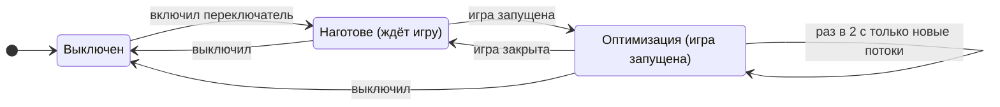
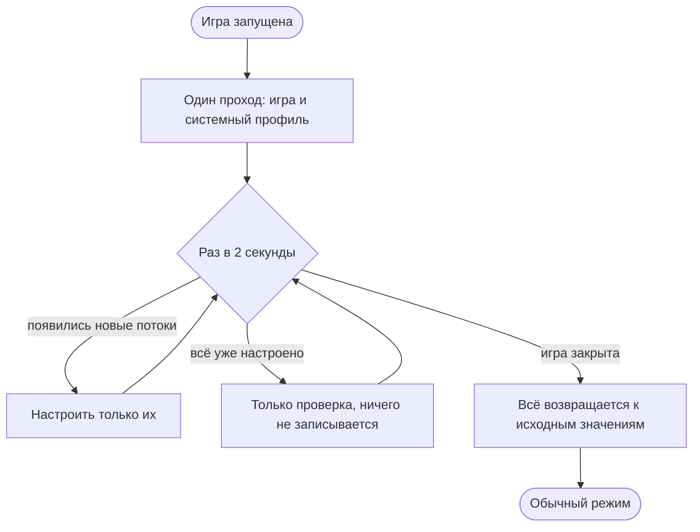

# grobyq 4.0

**Оптимизатор потоков и ядер для CS2 и Dota 2 · AerialOS edition**

> [!abstract] Коротко
> **grobyq** — программа для киберспортивных ПК на **AerialOS**. Она распределяет процессорное время и ядра так, чтобы потоки игры получали их первыми, а фоновые программы, системные службы и прерывания устройств не мешали игре.
>
> **4.0** — полностью новая программа на современной платформе: проще в управлении, аккуратнее с системой и с главной целью — ровный frame-time без микрофризов.

> [!important] Что нового в 4.0.5 (альфа)
> - **Тест приоритетов** на вкладке «Потоки»: MainThrd, D3D11RenderThread и GlobPool переключаются прямо в программе, без параметров запуска. Выбор применяется сразу, пока работает оптимизатор игровых потоков и запущена игра, и держится до «Выключить тест».
>   - MainThrd и рендер: эталон, «Как ставит игра», «Обычный» (8), «Выше среднего» (9), «Высокий» (10), «Критичный по времени» (15).
>   - GlobPool: эталон, «Как ставит игра», «Обычный», «Выше среднего», «Высокий» (10). Уровня 15 для пула нет: пять загруженных потоков на 15 заберут свои ядра у всех потоков ниже.
>   - «Критичный по времени» (15) один раз за запуск просит подтверждение. Это верх обычного диапазона, а не реальное время: у потока в процессе с обычным классом уровня выше 15 нет, а класс реального времени grobyq не ставит никогда.
> - **Журнал для A/B:** каждый выбор записывается строкой [AB] со всем вариантом, и для каждого потока видно, какой приоритет был у игры до grobyq («game Highest -> TimeCritical»). Изменения приоритетов теперь пишутся как «было -> стало».
> - **Параметр запуска `-mainthreadpriority`** перекрывается выбором в тесте. Чтобы проверить сам параметр, поставь в строке MainThrd «Как ставит игра» — журнал покажет уровень, который выставила игра.

> [!note]- 4.0.4 (альфа)
> - **Эталон встроен в программу.** Вкладка «Потоки» стала компактнее: эталон для выбранной игры показан списком — поток, подпись, приоритет. Редактор свёрнут под кнопкой «Настроить эталон», «Вернуть эталон» возвращает встроенный. Пресет на эталоне обновляется вместе с программой, свои правила при обновлении сохраняются.
> - **Пул задач GlobPool — на ступень выше:** «Выше среднего» (приоритет 9) вместо «обычного» (8). Главный поток раздаёт ему работу кадра и ждёт все его потоки. Главный поток остаётся выше всех (10).
> - **Правила потоков без отдельного переключателя:** включил оптимизатор игровых потоков — работает весь эталон игры.
> - **Политика повышения приоритета (boost):** boost остаётся там, где поток должен просыпаться вовремя: звук (audiodg, служба звука в svchost), композиция и ввод (dwm, csrss, ctfmon), системные службы (svchost, winlogon). Выключен он только у нагруженных фоновых программ — explorer, NVIDIA, Discord, поиск, WMI, webview и других, всего 17 процессов. Приоритеты системного профиля прежние: DWM и остальные выбранные потоки — на самом низком.
> - **ctfmon и TextInputHost — целиком на самом низком приоритете:** и процесс, и все его потоки (Idle).
> - **Оптимизатор системных потоков всегда работает целиком** и один раз спрашивает подтверждение при включении. Если в 4.0.3 был выбран вариант «Без защищённых», после обновления оптимизатор выключен — включи его снова и подтверди.
> - **Сброс до заводских настроек** (на «Потоках» и в «Настройках») срабатывает сразу, без перезапуска: оба оптимизатора выключаются, все изменения возвращаются, настройки, игры и эталон — как при первом запуске, автозапуск удаляется. Язык, лицензия и резервные копии «Привязки» остаются.
> - Из системного профиля убраны разделы игр: игрой занимается эталон оптимизатора игровых потоков.

> [!note]- 4.0.3 (альфа)
> - **«Привязка» временно закрыта:** раздел открывает страницу «Ведутся технические работы». Пока он дорабатывается, маска ядер игры и правила ядер для процессов не применяются. Если через «Привязку» раньше менялись прерывания или ReservedCpuSets, на этой странице есть кнопка вернуть исходное.
> - **Главный поток (MainThrd) — «Высокий» (Highest), рендер-поток (D3D11RenderThread) — «Выше среднего»** во встроенном пресете CS2 и Dota 2. Сохранённый пресет со встроенным значением обновляется один раз; значения, выставленные вручную, не трогаются.
> - **Правила потоков включены по умолчанию:** включил оптимизатор игровых потоков — работает весь пресет игры. Первый запуск по-прежнему ничего не меняет: сами оптимизаторы выключены.
> - **«Описание / модуль» больше не выбирается:** определяется по шаблону. Имя файла (.dll, .exe, .node) — это модуль, в котором стартует поток, всё остальное — описание потока.
> - **Подписи потоков:** у известных потоков под шаблоном видно, что это за поток (главный поток, рендер, Steam Audio, сеть Steam, драйвер NVIDIA, потоки Unreal Engine и другие).

> [!note]- 4.0.2 (альфа)
> Главная задача версии — frame-time: с grobyq 4.0.1 время кадра в CS2 было хуже, чем без программы. Точная причина пока не доказана, поэтому в 4.0.2 сразу убраны все части под подозрением; результат проверяется замером frame-time.
> - **Безопасные значения по умолчанию для CS2 и Dota 2:** главный поток (MainThrd) и рендер-поток (D3D11RenderThread) — «Выше среднего» вместо «Высокого» (Highest) и без закреплённого идеального ядра. Сохранённый пресет со старыми встроенными значениями обновляется один раз при первом запуске; значения, выставленные вручную, не трогаются.
> - **Убраны «горячие потоки»:** grobyq больше сам не выбирает самые нагруженные безымянные потоки игры и не даёт им ядро и приоритет. Потоки игры меняют только правила.
> - **Маска ядер игры при обновлении один раз выключается.** Включить обратно — «Привязка» → «Ядра».
> - **Убраны список фоновых программ и чистый игровой режим.** ctfmon.exe и TextInputHost.exe перенесены в оптимизатор системных потоков: пока идёт игра, они на самом низком приоритете (Idle).
> - **«Оптимизировать потоки» теперь называется «Применять правила потоков»** и стоит в карточке правил потоков; отдельного раздела «Оптимизатор игр» больше нет.
> - **Как проверить:** CapFrameX, одна карта или демка, avg и 1% low: без grobyq → только игровой оптимизатор → + системный. Если с grobyq всё ещё хуже — следующий подозреваемый системный профиль (правила для DWM, explorer, NVIDIA).

> [!note]- 4.0.1 (альфа)
> - **Оптимизация держится всю игру:** применяется один раз при запуске и держится до закрытия игры. Alt+Tab ничего не сбрасывает и не применяет заново.
> - **Чистый игровой режим (по желанию):** отмеченные фоновые программы закрываются при запуске игры и сами открываются после неё. Программы именно просят закрыться — принудительно ничего не завершается.
> - **Главный поток и рендер-поток игры — «Высокий» (Highest)** во встроенном пресете CS2 и Dota 2.
> - **Приоритет процесса игры по умолчанию — «обычный»**, как в Windows. High — по желанию в пресете игры.
> - **CPU 0 больше не избегается:** горячие потоки игры могут получить любое ядро, маска игры по умолчанию — все ядра.
> - **Системный профиль работает как написан:** правила -15 / 200 / 300 ставят потоки DWM, служб Windows и Steam на самый низкий приоритет — в этом суть игрового профиля.
> - **Меньше переключателей:** убраны «Только пока игра на экране», «Защита от зависаний» и «Приоритет процесса игры»; новые потоки подхватываются всегда.
> - **Нумерация версий:** 4.0.1, 4.0.2 … 4.0.9, затем 4.1.0. Пока всё это альфа, потом бета, релиз — примерно к 8.0.
> - Исправлено: проход оптимизатора делал около 90 снимков списка процессов вместо одного.

---

## Путь программы

| Версия | Что это было |
|---|---|
| **1.0** | Набор скриптов (PowerShell / .cmd): приоритеты и ядра для CS2, настройка вручную. |
| **2.0** | Первая оболочка с интерфейсом: разделы Home, Threads, Affinity, Profiles, Cleanup, Power plan. |
| **3.0** | Полноценная программа для Windows (.exe): рекомендация маски ядер под процессор, лицензия по HWID. |
| **3.x** (3.1 → 3.6.8) | **3.1** — «игровой набор» ядер для двухчиплетных X3D **3.2** — потоки и ядра на отдельных вкладках новое имя — **grobyq**, работа только на AerialOS, подписанный список лицензий **3.6.5** — адаптивная маска игры: ядра, занятые прерываниями, уходят из маски **3.6.6** — выбор ядра для прерываний с учётом устройства процессора **3.6.7** — живая проверка, куда на самом деле идут прерывания встроенный профиль системных потоков, очистка системы, журнал убраны вкладки «Устройства и драйверы» и «План электропитания» |
| **4.0** | Переписана с нуля на WPF / .NET 8 — подробно ниже. |

---

## Что есть в 4.0

### 1. Новая платформа

- **WPF / .NET 8** вместо WinForms: плавный интерфейс, единый тёмный стиль, окна лицензии и анимация запуска выполнены в том же стиле.
- **Три языка:** русский, украинский, английский.
- **Установщик:** ставится в Program Files, с ярлыками и удалением. При обновлении просит закрыть запущенную копию, при удалении убирает задачу автозапуска.

### 2. Ручной режим: ничего не меняется само

> [!success] Принцип
> При первом запуске Windows остаётся «как есть». Каждую часть оптимизации включаешь сам, изменения сохраняются кнопкой **«Сохранить»**, кнопка **«Отмена»** их отбрасывает. Любое изменение обратимо.

### 3. Два оптимизатора и игровая сессия

| Переключатель | Что делает |
|---|---|
| **Оптимизатор игровых потоков** | Встроенный эталон игры: процессная часть и правила потоков — главный поток, пул задач, рендер. Маска ядер и правила привязки к ядрам — в разделе «Привязка», он временно закрыт. |
| **Оптимизатор системных потоков** | Встроенный профиль приоритетов для системных процессов, NVIDIA, Steam, Discord и других: 37 процессов, 199 правил для потоков; ctfmon и TextInputHost на время игры целиком уходят на самый низкий приоритет. Только приоритет и повышение приоритета, всё обратимо. При первом включении один раз спрашивает подтверждение. |

Оба переключателя есть на вкладке «Потоки» и в меню трея и после перезапуска остаются в том положении, в каком их оставили. Применяются они, **пока запущена игра**:

> [!tip] Почему так
> Раньше каждые 2 секунды всё выставлялось заново, в том числе привязка игры к ядрам. Из-за этого потоки игры могли перескакивать между ядрами. В 4.0 всё ставится один раз при запуске игры, а повторный проход только проверяет и настраивает новые потоки. Alt+Tab ничего не сбрасывает — при возврате в игру не нужен повторный проход, а значит, нет и рывка в этот момент. Цель — убрать периодические микрофризы. Результат подтверждаем замерами frame-time, а не на глаз.

> [!info] Системный профиль
> Профиль применяется как написан: правила -15 / 200 / 300 ставят потоки DWM, служб Windows, Steam, NVIDIA-контейнеров и других программ на самый низкий приоритет (Idle), чтобы во время игры они не отнимали у неё процессор. Поток на самом низком приоритете проигрывает любой занятой программе, поэтому тяжёлые программы (браузер) на время матча лучше закрыть.
>
> **Повышение приоритета (boost)** — короткий подъём приоритета у потока, который проснулся по событию (ввод, завершение ввода-вывода, сообщение окна); с каждым квантом он спадает. Boost остаётся у звука, композиции, ввода и системных служб. Выключен он только у нагруженных фоновых программ: у них поток с обычным приоритетом после пробуждения на мгновение догоняет потоки игры. Влияние профиля на frame-time ещё не измерено — это следующий шаг A/B.

### 4. Игры

- **CS2** и **Dota 2** включаются галочками.
- Любую другую игру можно добавить кнопкой **«Добавить игру»** (выбрать её .exe) — она появится плашкой, лишнюю убирают крестиком.

### 5. Эталон игры и правила потоков

- В блоке **«Эталон»** выбираешь игру и видишь, что задаёт оптимизатор: каждое правило потока с подписью и приоритетом, ниже одной строкой — процессная часть (класс, ввод-вывод, память, EcoQoS, повышение приоритета).
- Метка рядом с игрой: **«встроенный эталон»** — пресет совпадает со встроенным в эту версию и обновляется вместе с программой; **«свои правила»** — пресет изменён на этом ПК и при обновлении сохраняется. Кнопка **«Вернуть эталон»** сразу возвращает встроенный.
- **«Настроить эталон»** раскрывает редактор: класс приоритета (по умолчанию «обычный», High — по желанию, Realtime запрещён), ввод-вывод, память, EcoQoS, повышение приоритета процесса и правила потоков. Изменения сохраняются кнопкой «Сохранить».
- **Правила потоков:** поток находится по описанию или по модулю, из которого он запущен, — что именно, определяется по шаблону (имя файла .dll / .exe / .node — модуль). Правила проверяются сверху вниз, срабатывает первое подходящее.
- Встроенный эталон есть для CS2, Dota 2, VALORANT и Fortnite. Эталон CS2 и Dota 2 (числа — при классе «обычный», база 8):

| Поток | Приоритет | Почему |
|---|---|---|
| MainThrd — главный | «Высокий» (Highest), 10 | Считает кадр; игра сама ставит ему Highest |
| D3D11RenderThread — рендер | «Выше среднего», 9 | Отдаёт кадр драйверу; игра сама ставит Above normal |
| GlobPool/0..4 — пул задач | «Выше среднего», 9 — **новое в 4.0.4** | Главный поток раздаёт им работу кадра и ждёт все; игра оставляет их на «обычном» (8) |
| embree3, phonon — Steam Audio | «Самый низкий» | Трассировка звука; по замеру в матче почти без нагрузки |
| video64 — видео | «Ниже среднего» | Видео на фоне меню |

- Повышение приоритета у потоков игры не меняется (по замеру у всех включено), идеальное ядро не задаётся. В 4.0.1 главный поток и рендер стояли на «Высоком» со своим ядром — это под подозрением в ухудшении frame-time. Результат проверяется замером.

> [!tip] Тест приоритетов (4.0.5)
> Под эталоном — блок «Тест приоритетов»: три строки (MainThrd, D3D11RenderThread, GlobPool) с выбором уровня. Первая строка списка — уровень эталона, то есть «теста нет»; дальше «Как ставит игра» и другие уровни с числом приоритета. Тест действует только для CS2 и Dota 2 и только при включённом оптимизаторе игровых потоков. Как сравнивать: один и тот же прогон в CapFrameX на каждый вариант, время варианта — по строке [AB] в журнале.

> [!question] Почему «обычный», а не High
> High поднимает игру над всеми программами с обычным приоритетом — в том числе над теми, кого игра сама ждёт (DWM собирает кадр, Steam отвечает на запросы игры). Выигрыш, если он есть, даёт настройка потоков, а не повышение всего процесса. Если замер покажет, что игре не хватает процессора, High можно включить в пресете.

### 6. Фоновые программы

> [!warning] Убраны в 4.0.2
> Список фоновых программ (понижение приоритета, перенос на свободные ядра) и чистый игровой режим (закрытие и повторное открытие программ) убраны. Остались два процесса ввода текста — ctfmon.exe и TextInputHost.exe: на время игры их опускает оптимизатор системных потоков. Свои ядра для программы по-прежнему задаются в «Привязка» → «Процессы».

### 7. Привязка к ядрам

> [!warning] Временно закрыта (4.0.3)
> Раздел дорабатывается: вместо вкладок открывается страница «Ведутся технические работы», маска ядер игры и правила ядер для процессов не применяются. Ниже — что вернётся после доработки.

| Вкладка | Что делает |
|---|---|
| **Ядра** | Маска ядер игры с учётом процессора: X3D (чиплет с кэшем), гибридные Intel (P-ядра), SMT. По умолчанию — все ядра, включая CPU 0; «без CPU 0» — шаг для A/B-проверки. Ядра, на которые закреплены прерывания устройств, автоматически уходят из маски игры (это можно выключить). |
| **Процессы** | Свои правила ядер для любой программы (как мини-Process Lasso): голосовой чат, VPN, стрим. |
| **Прерывания** | Настройка прерываний устройств (сеть, видеокарта, USB): MSI, лимит сообщений, политика и целевые ядра, приоритет. Есть рекомендация ядра; оригинал сохраняется и возвращается одной кнопкой. |
| **Резервирование** | ReservedCpuSets: Windows не ставит обычные задачи на выбранные ядра (действует после перезагрузки). С резервной копией и откатом. |

> [!question] Почему CPU 0 больше не убирается
> Само по себе CPU 0 ничем не хуже других ядер. Мешают ядра, на которые закреплены прерывания устройств, — grobyq читает эти закрепления из реестра и убирает из маски игры ровно их. Убирать CPU 0 «на всякий случай» — значит отнимать у игры целое ядро без доказательств.

### 8. Обслуживание

- **Очистка системы:** временные файлы, кэши обновлений, старые логи, отчёты об ошибках, кэши шейдеров и браузеров.
  - Сначала сканирование с размерами; удаляется только по кнопке. Занятые файлы пропускаются.
  - Глубокие инструменты Windows (очистка WinSxS через DISM, Disk Cleanup) — с предупреждениями.
  - Prefetch намеренно не трогается: без него программы запускаются медленнее.
- **Журнал:** каждое действие записывается с отметкой времени — основа для честных сравнений «до и после».

### 9. Трей

Меню-карточка в стиле программы: статус (клик открывает окно), два переключателя оптимизаторов, «О программе», «Выход». Двойной клик по значку открывает или скрывает окно.

### 10. Лицензия и AerialOS

- Работает **только на AerialOS**. Исключение — лицензия с отметкой для любой Windows, она для разработки и тестов.
- Лицензия привязана к железу (HWID) и проверяется по **подписанному списку**: подделать запись или перенести её на другой ПК нельзя.
- Без интернета лицензия действует **48 часов**.

### 11. Защита и качество сборки

- Каждая версия собирается автоматически, код защищён от разбора (обфускация).
- Перед выпуском защищённая версия проходит **самопроверку**: интерфейс, языки, определение процессора, профиль, доступ к списку лицензий, компиляция всех методов. Если защита что-то сломала, такая сборка не выходит.
- Подпись кода (Authenticode) подключается, как только будет сертификат.

---

## Принципы безопасности

| Правило | Почему |
|---|---|
| Никогда класс **Realtime** | Он может «задушить» ввод и звук. |
| Потоки **не замораживаются и не завершаются** | Заморозка системного потока — это зависание, потока игры или античита — риск бана. Вместо этого потоку ставится низкий приоритет. |
| Программы **не закрываются** | grobyq не закрывает и не завершает чужие программы: меняются только приоритеты, после игры всё возвращается. |
| **Античиты не трогаются вообще** | FACEIT, Vanguard, Easy Anti-Cheat, BattlEye и другие: ни процессы, ни их модули, ни при каких настройках. |
| Защищённые процессы Windows — **только с разрешения** | Меняется только приоритет потоков и только после подтверждения при включении оптимизатора системных потоков. |
| **Всё обратимо** | Выключение и выход возвращают исходные значения, при сбое срабатывает аварийный откат. |
| **Ничего само** | Ручной режим, сохранение только по кнопке. |

---

## Было → стало (3.6.8 → 4.0)

| | 3.6.8 | 4.0 |
|---|---|---|
| Платформа | WinForms | **WPF / .NET 8** |
| Включение | одна большая кнопка «Включить» | **два переключателя**: игровые и системные потоки |
| Когда работает | всё время, пока включено | **пока запущена игра**: один проход при запуске, закрыл игру — обычный режим |
| Повторное применение | каждые 2 с всё заново | **один раз**, дальше только новые потоки |
| Приоритет процесса игры | High | **обычный** по умолчанию, High — по желанию |
| CPU 0 | избегался горячими потоками и маской по умолчанию | **доступен игре**; «без CPU 0» — шаг A/B |
| Игры | ввод имени .exe | **галочки** CS2 / Dota 2 + свои игры |
| Пресет и правила потоков | отдельные таблицы, изменения сразу | **встроенный эталон** списком, редактор — по кнопке, **«Сохранить» / «Отмена»** |
| Фоновые программы | таблица, только понижение | **убраны** (4.0.2); ctfmon и TextInputHost — в системном профиле |
| Меню в трее | системное меню | **карточка с переключателями** |
| Профили, импорт .ini, потоки в реальном времени | были | **убраны**: один встроенный профиль, программа компактнее |
| Выпуск | ручная сборка | **автосборка**, защита кода, самопроверка, установщик |

---

## Как проверяем результат

> [!note] Без «плацебо»
> Улучшения подтверждаем измерениями, а не FPS в меню:
> - **frame-time** — 1% и 0.1% low, провалы кадров (PresentMon / CapFrameX);
> - **трассы WPR / WPA** — кто занимает ядра игры, задержки DPC / ISR;
> - **A/B** на одной карте или демке: без grobyq → игровой оптимизатор → + системный.
>
> Журнал grobyq показывает, в какой момент что применялось и когда возвращалось.

---

## Куда движемся

- [ ] A/B 4.0.4: без grobyq → игровой оптимизатор (с GlobPool) → + системный (CapFrameX, avg / 1% low)
- [ ] A/B 4.0.5 в тесте приоритетов: MainThrd 10 / 15, рендер 9 / 10, пул 9 / 10 — лучший вариант перенести в эталон
- [ ] A/B-замеры системного профиля (в том числе правил для DWM) и правка профиля по данным
- [ ] Монитор помех: кто вытесняет главный поток, пул задач и рендер (ETW), отчёт после матча
- [ ] Вернуть «Привязку» после доработки
- [ ] Новая вкладка «Потоки»: потоки игры в реальном времени (пулы, главные потоки) с подписями, привязка к ядру и приоритет для каждого потока
- [ ] Подпись кода (Authenticode)
- [ ] Обновление прямо из программы: выпуск из grobyq Admin, у клиента — кнопка «Обновить»
- [ ] Сетевой модуль из grobPC-NetTune: обработка сети на выбранном ядре, тест MTU
- [ ] Проверка совместимости с Akros Anti-Cheat (турнирный режим)

---

## Быстрый старт

1. Установить и запустить. Если ПК ещё нет в списке лицензий — отправить показанный HWID.
2. **Потоки** → отметить игры → **«Сохранить»**.
3. Включить оптимизаторы (вверху вкладки «Потоки» или в меню трея); системный при первом включении спросит подтверждение.
4. Запустить игру. Оптимизация применяется при запуске и держится до закрытия игры.
5. Сравнить frame-time с grobyq и без него (CapFrameX, avg / 1% low) — см. «Как проверяем результат».

---

> [!info]- Словарик
> - **Поток** — отдельная «нить» работы внутри программы. У игры их десятки: главный поток, рендер, звук, сеть.
> - **Приоритет потока** — кто первым получает процессор, когда на одно ядро претендуют несколько потоков.
> - **Ядро / логический процессор (LP)** — исполнитель задач. При SMT / Hyper-Threading одно физическое ядро даёт два логических.
> - **Привязка (affinity)** — на каких ядрах программе разрешено работать.
> - **Прерывание (IRQ)** — сигнал от устройства (сеть, мышь, видеокарта), который на мгновение отвлекает ядро.
> - **MSI** — современный способ доставки прерываний, их можно точно направить на нужное ядро.
> - **Frame-time** — время одного кадра. Ровный frame-time — это плавная игра без микрофризов.
> - **DWM** — диспетчер окон Windows, собирает картинку на экране.
> - **EcoQoS** — режим энергосбережения Windows для процесса. Для игры он выключается.
> - **X3D / CCD** — процессоры AMD с дополнительным кэшем на одном из чиплетов (CCD). Игре выгоднее работать на нём.

---

grobyq by **mitzu LLC · grobPC** · AerialOS edition · сборка 4.0.5 alpha · 23.10.2026 grobpc.com · x.com/grobPC · aerialos.vercel.app · dsc.gg/aerialos
