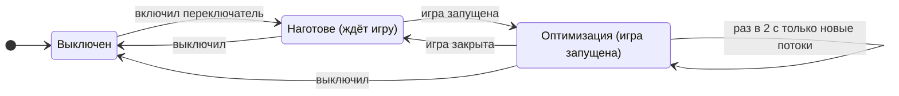
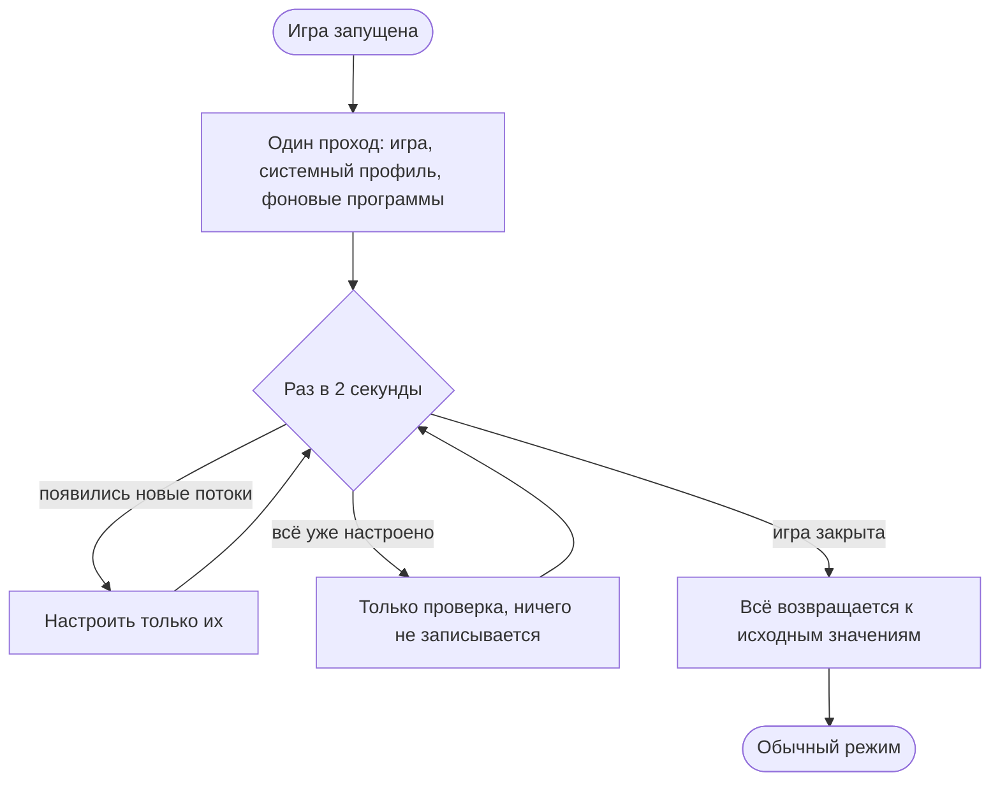
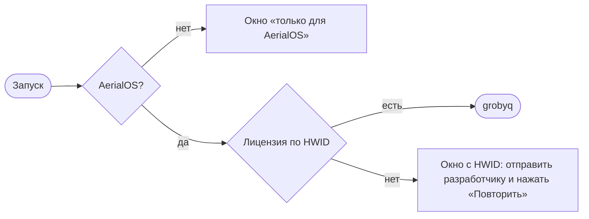

# grobyq 4.0

**Оптимизатор потоков и ядер для CS2 и Dota 2 · AerialOS edition**

> [!abstract] Коротко
> **grobyq** — программа для киберспортивных ПК на **AerialOS**. Она распределяет процессорное время и ядра так, чтобы потоки игры получали их первыми, а фоновые программы, системные службы и прерывания устройств не мешали игре.
>
> **4.0** — полностью новая программа на современной платформе: проще в управлении, аккуратнее с системой и с главной целью — ровный frame-time без микрофризов.

> [!note] Что нового в alpha.5 – alpha.7
> - **Оптимизация держится всю игру:** применяется один раз при запуске и держится до закрытия игры. Alt+Tab ничего не сбрасывает и не применяет заново. Прежний режим «только пока игра на экране» — по желанию.
> - **Чистый игровой режим (по желанию):** отмеченные фоновые программы закрываются при запуске игры и сами открываются после неё. Программы именно просят закрыться — принудительно ничего не завершается.
> - **Приоритет процесса игры по умолчанию — «обычный»**, как в Windows. High — по желанию в пресете игры.
> - **CPU 0 больше не избегается:** горячие потоки игры могут получить любое ядро, маска игры по умолчанию — все ядра.
> - **Системный профиль работает как написан:** правила -15 / 200 / 300 ставят потоки DWM, служб Windows и Steam на самый низкий приоритет — в этом суть игрового профиля. «Защита от зависаний» осталась запасным переключателем и по умолчанию выключена.
> - Исправлено: проход оптимизатора делал около 90 снимков списка процессов вместо одного.

---

## Путь программы

| Версия | Что это было |
|---|---|
| **1.0** | Набор скриптов (PowerShell / .cmd): приоритеты и ядра для CS2, настройка вручную. |
| **2.0** | Первая оболочка с интерфейсом: разделы Home, Threads, Affinity, Profiles, Cleanup, Power plan. |
| **3.0** | Полноценная программа для Windows (.exe): рекомендация маски ядер под процессор, лицензия по HWID. |
| **3.x** (3.1 → 3.6.8) | **3.1** — «игровой набор» ядер для двухчиплетных X3D **3.2** — потоки и ядра на отдельных вкладках новое имя — **grobyq**, работа только на AerialOS, подписанный список лицензий **3.6.5** — адаптивная маска игры: ядра, занятые прерываниями, уходят из маски **3.6.6** — выбор ядра для прерываний с учётом устройства процессора **3.6.7** — живая проверка, куда на самом деле идут прерывания встроенный профиль системных потоков, очистка системы, журнал убраны вкладки «Устройства и драйверы» и «План электропитания» |
| **4.0** | Переписана с нуля на WPF / .NET 8 — подробно ниже. |

---

## Что есть в 4.0

### 1. Новая платформа

- **WPF / .NET 8** вместо WinForms: плавный интерфейс, единый тёмный стиль, окна лицензии и анимация запуска выполнены в том же стиле.
- **Три языка:** русский, украинский, английский.
- **Установщик:** ставится в Program Files, с ярлыками и удалением. При обновлении просит закрыть запущенную копию, при удалении убирает задачу автозапуска.

### 2. Ручной режим: ничего не меняется само

> [!success] Принцип
> При первом запуске Windows остаётся «как есть». Каждую часть оптимизации включаешь сам, изменения сохраняются кнопкой **«Сохранить»**, кнопка **«Отмена»** их отбрасывает. Любое изменение обратимо.

### 3. Два оптимизатора и игровая сессия

| Переключатель | Что делает |
|---|---|
| **Оптимизатор игровых потоков** | Приоритет процесса игры, маска ядер, настройка потоков игры, понижение фоновых программ, правила привязки к ядрам. Работает только то, что включено и сохранено. |
| **Оптимизатор системных потоков** | Встроенный профиль приоритетов для системных процессов, NVIDIA, Steam, Discord и других: 41 процесс, 242 правила для потоков, 31 фоновая программа. Только приоритет и повышение приоритета, всё обратимо. |

Оба переключателя есть на вкладке «Потоки» и в меню трея и после перезапуска остаются в том положении, в каком их оставили. Применяются они, **пока запущена игра**:

> [!tip] Почему так
> Раньше каждые 2 секунды всё выставлялось заново, в том числе привязка игры к ядрам и «идеальное ядро» самых нагруженных потоков. Из-за этого потоки игры могли перескакивать между ядрами. В 4.0 всё ставится один раз при запуске игры, у каждого потока своё постоянное ядро, а повторный проход только проверяет и настраивает новые потоки. Alt+Tab ничего не сбрасывает — при возврате в игру не нужен повторный проход, а значит, нет и рывка в этот момент. Цель — убрать периодические микрофризы. Результат подтверждаем замерами frame-time, а не на глаз.

Переключатель **«Только пока игра на экране»** (по умолчанию выключен) возвращает прежний режим: свернул игру или Alt+Tab — всё возвращается к обычному, вернулся в игру — применяется снова.

> [!info] Системный профиль и защита от зависаний
> Профиль применяется как написан: правила -15 / 200 / 300 ставят потоки DWM, служб Windows и Steam на самый низкий приоритет (Idle) — во время игры они не отнимают у неё процессор. Чтобы этим потокам самим не мешали занятые программы, такие программы лучше закрывать чистым игровым режимом.
>
> Переключатель **«Защита от зависаний»** (по умолчанию выключен) — запасной вариант: если игра зависает на секунды, пока открыт занятый браузер, он не даёт этим процессам опуститься ниже «ниже среднего».

### 4. Игры

- **CS2** и **Dota 2** включаются галочками.
- Любую другую игру можно добавить кнопкой **«Добавить игру»** (выбрать её .exe) — она появится плашкой, лишнюю убирают крестиком.

### 5. Пресет игры и правила потоков

- Выбираешь игру из списка и настраиваешь:
  - **класс приоритета** — по умолчанию «обычный», как в Windows; High — по желанию; Realtime запрещён;
  - **приоритет ввода-вывода и памяти**;
  - **EcoQoS** (энергосбережение Windows для процесса игры выключено);
  - **повышение приоритета** процесса;
  - **приоритеты «горячих» потоков** — самых нагруженных потоков игры. Им достаётся любое ядро, включая CPU 0.
- **Правила потоков:** поток находится по названию или по модулю, из которого он запущен. Для него задаются приоритет, идеальное ядро и повышение приоритета. Правила проверяются сверху вниз.
- Есть встроенные пресеты для CS2, Dota 2, VALORANT и Fortnite. Кнопка **«Встроенный»** возвращает исходный.

> [!question] Почему «обычный», а не High
> High поднимает игру над всеми программами с обычным приоритетом — в том числе над теми, кого игра сама ждёт (DWM собирает кадр, Steam отвечает на запросы игры). Выигрыш даёт настройка потоков и фоновых программ, а не повышение всего процесса. Если замер покажет, что игре не хватает процессора, High можно включить в пресете.

### 6. Фоновые программы

- Список плашками: Discord, браузеры, OBS, Steam, Spotify, Telegram и другие.
- Пока игра запущена, каждая программа получает то, что на её плашке (клик переключает): класс **«ниже среднего»**, **«простой»** или **«обычный»** с пониженным вводом-выводом и памятью — или **«Закрыть»**.
- По желанию их можно перевести на ядра вне игровой маски.
- Новую программу добавляют из списка запущенных или выбором .exe.

#### Чистый игровой режим

Переключатель **«Закрывать фоновые программы при запуске игры»** в разделе «Фоновые программы». По умолчанию выключен.

- Программа получает обычный запрос на закрытие — как при нажатии на крестик. Принудительно grobyq ничего не завершает: программа может спросить о сохранении, а та, что сворачивается в трей, уйдёт в трей.
- После игры открываются ровно те программы, которые закрыл grobyq, — с обычными правами, как при двойном клике.
- Если режим выключить посреди игры, закрытые программы откроются сразу.
- Steam и его службы, системные процессы (включая explorer) и античиты закрыть нельзя.

### 7. Привязка к ядрам

| Вкладка | Что делает |
|---|---|
| **Ядра** | Маска ядер игры с учётом процессора: X3D (чиплет с кэшем), гибридные Intel (P-ядра), SMT. По умолчанию — все ядра, включая CPU 0; «без CPU 0» — шаг для A/B-проверки. Ядра, на которые закреплены прерывания устройств, автоматически уходят из маски игры (это можно выключить). |
| **Процессы** | Свои правила ядер для любой программы (как мини-Process Lasso): голосовой чат, VPN, стрим. |
| **Прерывания** | Настройка прерываний устройств (сеть, видеокарта, USB): MSI, лимит сообщений, политика и целевые ядра, приоритет. Есть рекомендация ядра; оригинал сохраняется и возвращается одной кнопкой. |
| **Резервирование** | ReservedCpuSets: Windows не ставит обычные задачи на выбранные ядра (действует после перезагрузки). С резервной копией и откатом. |

> [!question] Почему CPU 0 больше не убирается
> Само по себе CPU 0 ничем не хуже других ядер. Мешают ядра, на которые закреплены прерывания устройств, — grobyq читает эти закрепления из реестра и убирает из маски игры ровно их. Убирать CPU 0 «на всякий случай» — значит отнимать у игры целое ядро без доказательств.

### 8. Обслуживание

- **Очистка системы:** временные файлы, кэши обновлений, старые логи, отчёты об ошибках, кэши шейдеров и браузеров.
  - Сначала сканирование с размерами; удаляется только по кнопке. Занятые файлы пропускаются.
  - Глубокие инструменты Windows (очистка WinSxS через DISM, Disk Cleanup) — с предупреждениями.
  - Prefetch намеренно не трогается: без него программы запускаются медленнее.
- **Журнал:** каждое действие записывается с отметкой времени — основа для честных сравнений «до и после».

### 9. Трей

Меню-карточка в стиле программы: статус (клик открывает окно), два переключателя оптимизаторов, «О программе», «Выход». Двойной клик по значку открывает или скрывает окно.

### 10. Лицензия и AerialOS

- Работает **только на AerialOS**. Исключение — лицензия с отметкой для любой Windows, она для разработки и тестов.
- Лицензия привязана к железу (HWID) и проверяется по **подписанному списку**: подделать запись или перенести её на другой ПК нельзя.
- Без интернета лицензия действует **48 часов**.

### 11. Защита и качество сборки

- Каждая версия собирается автоматически, код защищён от разбора (обфускация).
- Перед выпуском защищённая версия проходит **самопроверку**: интерфейс, языки, определение процессора, профиль, доступ к списку лицензий, компиляция всех методов. Если защита что-то сломала, такая сборка не выходит.
- Подпись кода (Authenticode) подключается, как только будет сертификат.

---

## Принципы безопасности

| Правило | Почему |
|---|---|
| Никогда класс **Realtime** | Он может «задушить» ввод и звук. |
| Потоки **не замораживаются и не завершаются** | Заморозка системного потока — это зависание, потока игры или античита — риск бана. Вместо этого потоку ставится низкий приоритет. |
| Программы **только просят закрыться** | В чистом игровом режиме — обычный запрос на закрытие, без принудительного завершения; после игры программы открываются снова. |
| **Античиты не трогаются вообще** | FACEIT, Vanguard, Easy Anti-Cheat, BattlEye и другие: ни процессы, ни их модули, ни при каких настройках. |
| Защищённые процессы Windows — **только с разрешения** | Меняется только приоритет потоков и только после явного «Да». |
| **Всё обратимо** | Выключение и выход возвращают исходные значения, при сбое срабатывает аварийный откат. |
| **Ничего само** | Ручной режим, сохранение только по кнопке. |

---

## Было → стало (3.6.8 → 4.0)

| | 3.6.8 | 4.0 |
|---|---|---|
| Платформа | WinForms | **WPF / .NET 8** |
| Включение | одна большая кнопка «Включить» | **два переключателя**: игровые и системные потоки |
| Когда работает | всё время, пока включено | **пока запущена игра**: один проход при запуске, закрыл игру — обычный режим |
| Повторное применение | каждые 2 с всё заново | **один раз**, дальше только новые потоки |
| Приоритет процесса игры | High | **обычный** по умолчанию, High — по желанию |
| CPU 0 | избегался горячими потоками и маской по умолчанию | **доступен игре**; «без CPU 0» — шаг A/B |
| Игры | ввод имени .exe | **галочки** CS2 / Dota 2 + свои игры |
| Пресет и правила потоков | отдельные таблицы, изменения сразу | в одном месте, через **«Сохранить» / «Отмена»** |
| Фоновые программы | таблица, только понижение | **плашки**: понижение или **закрытие** с повторным открытием |
| Меню в трее | системное меню | **карточка с переключателями** |
| Профили, импорт .ini, потоки в реальном времени | были | **убраны**: один встроенный профиль, программа компактнее |
| Выпуск | ручная сборка | **автосборка**, защита кода, самопроверка, установщик |

---

## Как проверяем результат

> [!note] Без «плацебо»
> Улучшения подтверждаем измерениями, а не FPS в меню:
> - **frame-time** — 1% и 0.1% low, провалы кадров (PresentMon / CapFrameX);
> - **трассы WPR / WPA** — кто занимает ядра игры, задержки DPC / ISR;
> - **A/B** на одной карте или демке: без grobyq → игровой оптимизатор → + системный → + чистый игровой режим.
>
> Журнал grobyq показывает, в какой момент что применялось и когда возвращалось.

---

## Куда движемся

- [ ] A/B-замеры системного профиля (в том числе правил для DWM) и правка профиля по данным
- [ ] A/B: «держать всю игру» против «только пока игра на экране»
- [ ] Подпись кода (Authenticode)
- [ ] Обновление прямо из программы: выпуск из grobyq Admin, у клиента — кнопка «Обновить»
- [ ] Сетевой модуль из grobPC-NetTune: обработка сети на выбранном ядре, тест MTU
- [ ] Проверка совместимости с Akros Anti-Cheat (турнирный режим)

---

## Быстрый старт

1. Установить и запустить. Если ПК ещё нет в списке лицензий — отправить показанный HWID.
2. **Потоки** → отметить игры, включить нужные части → **«Сохранить»**.
3. Включить оптимизаторы (вверху вкладки «Потоки» или в меню трея).
4. Запустить игру. Оптимизация применяется при запуске и держится до закрытия игры.
5. По желанию — чистый игровой режим: поставить нужным программам плашку **«Закрыть»**, нажать **«Сохранить»** и включить **«Закрывать фоновые программы при запуске игры»**.

---

> [!info]- Словарик
> - **Поток** — отдельная «нить» работы внутри программы. У игры их десятки: главный поток, рендер, звук, сеть.
> - **Приоритет потока** — кто первым получает процессор, когда на одно ядро претендуют несколько потоков.
> - **Горячие потоки** — самые нагруженные потоки игры; grobyq даёт им «идеальное ядро» и при желании приоритет.
> - **Ядро / логический процессор (LP)** — исполнитель задач. При SMT / Hyper-Threading одно физическое ядро даёт два логических.
> - **Привязка (affinity)** — на каких ядрах программе разрешено работать.
> - **Прерывание (IRQ)** — сигнал от устройства (сеть, мышь, видеокарта), который на мгновение отвлекает ядро.
> - **MSI** — современный способ доставки прерываний, их можно точно направить на нужное ядро.
> - **Frame-time** — время одного кадра. Ровный frame-time — это плавная игра без микрофризов.
> - **DWM** — диспетчер окон Windows, собирает картинку на экране.
> - **EcoQoS** — режим энергосбережения Windows для процесса. Для игры он выключается.
> - **X3D / CCD** — процессоры AMD с дополнительным кэшем на одном из чиплетов (CCD). Игре выгоднее работать на нём.

---

grobyq by **mitzu LLC · grobPC** · AerialOS edition · сборка 4.0.0-alpha.7 · 14.10.2026 grobpc.com · x.com/grobPC · aerialos.vercel.app · dsc.gg/aerialos
